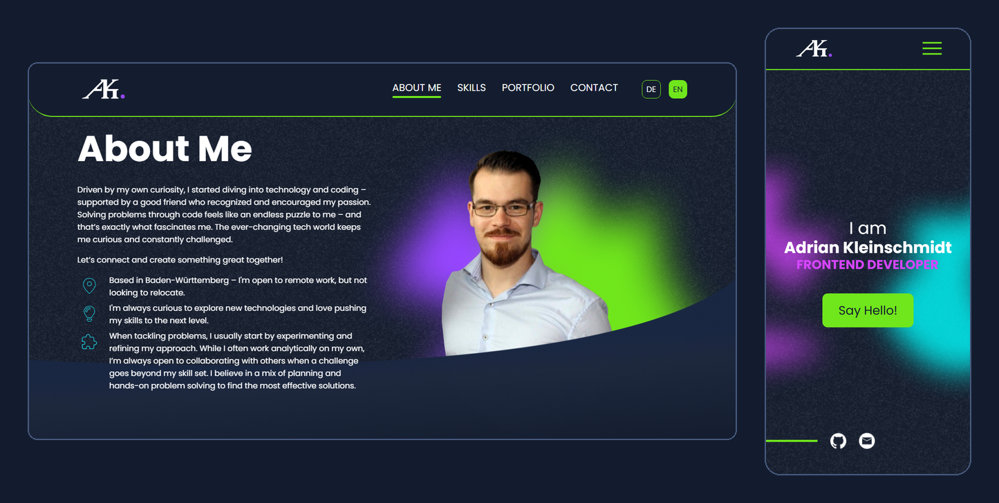

# Adrian Kleinschmidt · Portfolio

Personal portfolio of a frontend developer: a single-page site with scroll animations, a project showcase, a colleague review slider and a working contact form. Available in **English and German**.

**Live:** [akleinschmidt.net](https://akleinschmidt.net)



## Highlights

- **Fully responsive** from 320 px to wide desktop screens, with touch swipe for the review slider
- **DE / EN switch** driven by two JSON files, remembered per visitor, defaulting to the browser language
- **Scroll spy header:** border colour and active nav link follow the section in view
- **Scroll reveal** animations that fade in and out in both scroll directions, built on `IntersectionObserver` (respects reduced-motion settings)
- **Portfolio section** with hover previews and an info modal on desktop, inline project cards on tablet and mobile
- **Contact form** with live validation, sent through a small PHP script
- **Legal pages** (imprint and privacy policy) following German law, in both languages
- No cookies, trackers or third-party scripts

## Tech stack

Angular 19 (standalone components) · TypeScript · SCSS · Reactive Forms · RxJS · Zone.js · PHP (mail script)

No UI framework and no animation or i18n library: the reveal directive, the translation service and the scroll spy are written from scratch.

## Getting started

```bash
npm install
npm start          # dev server at http://localhost:4200
npm run build      # production build in dist/portfolio/browser
npm test           # unit tests (Karma + Jasmine)
```

The contact form posts to `/sendMail.php`. `ng serve` cannot run PHP, so sending only works on a PHP host; locally the form shows its error message.

## Deployment

Upload the **contents** of `dist/portfolio/browser` to the web root of an Apache host with PHP. The build already includes:

- `.htaccess`, which routes `/imprint` and `/privacy` to the single-page app
- `sendMail.php`, the contact form endpoint (set your own sender and recipient address at the top of the script)

## Project structure

```
src/app/          one folder per section (header, hero, about-me, skills, portfolio, contact, footer),
                  plus legal pages, language switch, i18n service and reveal directive
public/           static files served from the site root
public/assets/i18n/   de.json and en.json: all visible text
```

## Featured projects

| Project | Stack |
| --- | --- |
| [JOIN](https://github.com/kleinschmidta/JOIN) · [live](https://join.akleinschmidt.net/) | Task management app (Angular, Firebase) |
| [El Pollo Loco](https://github.com/kleinschmidta/ElPolloLoco) · [live](https://el-pollo-loco.akleinschmidt.net/) | Jump-and-run browser game (JavaScript, OOP) |
| [DABubble](https://github.com/kleinschmidta/DABubble) · [live](https://dabubble.akleinschmidt.net/) | Real-time chat app (Angular, Firebase) |

## Contact

[kontakt@akleinschmidt.net](mailto:kontakt@akleinschmidt.net) · [GitHub](https://github.com/kleinschmidta)
